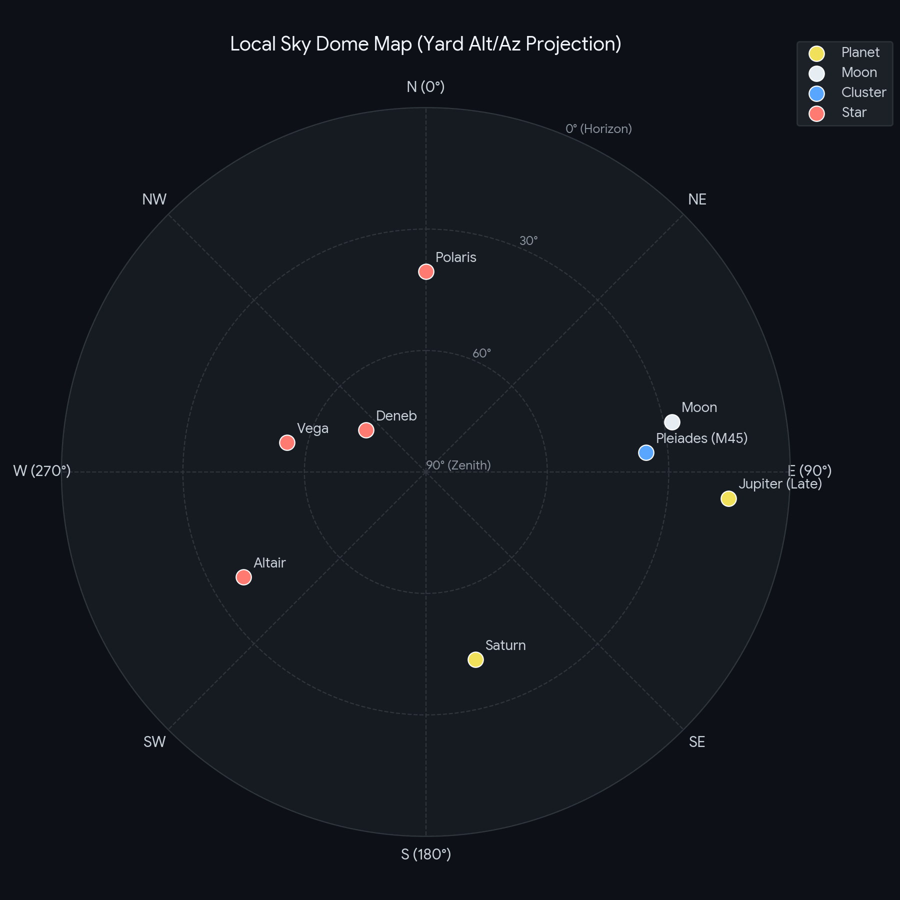

# SkyLog: Local Sky Dome Observation Engine

A lightweight command-line logging and polar projection tool for backyard telescope observations.

## Features
- Alt/Az horizontal coordinate logging
- Optical train magnification tracking
- Automated polar sky dome generation using Matplotlib

## Sample Map

